# WeChat SSO integration for CompShop

Investigation only — no app code changed. Date: 2026-02-14 (session time; file is not committed).

## What we have

- App: React + Vite PWA, Supabase JS client, invite-only signup.
- Auth today: Microsoft (`azure`), Google, email/password via self-hosted Supabase GoTrue **v2.186.0** at `https://api.comp.designflow.app`.
- OAuth callback already in use: `https://api.comp.designflow.app/auth/v1/callback`.
- Frontend URLs: `https://comp.designflow.app` (primary), `https://compshop.designflow.app`.
- Access control: `profiles.approval_status` + `auth_access_rules` (providers currently `*`, `email`, `google`, `azure`, `microsoft`). Invite check is email-based (`is_email_invited`).
- New account auto-provisioning is driven by a `auth.users` trigger that reads `raw_app_meta_data.provider`.

## What WeChat website login is

WeChat Open Platform **网站应用** with 微信登录 is OAuth 2.0 authorization-code, but **not** standard OAuth2/OIDC and **not** OIDC discovery.

| Step | WeChat behavior |
|------|-----------------|
| Authorize | `https://open.weixin.qq.com/connect/qrconnect?appid=…&redirect_uri=…&response_type=code&scope=snsapi_login&state=…#wechat_redirect` |
| UX | Desktop QR code (WxLogin.js embed or full-page). Fast login if WeChat desktop client is signed in. |
| Token | `GET https://api.weixin.qq.com/sns/oauth2/access_token?appid=…&secret=…&code=…&grant_type=authorization_code` |
| Profile | `GET https://api.weixin.qq.com/sns/userinfo?access_token=…&openid=…` → `openid`, `unionid`, `nickname`, `headimgurl`. **No email.** |
| PKCE | Not supported. |

Identity to store: prefer **`unionid`** as the stable user key (same person across future mini-program / official-account apps). Keep `openid` too.

## Why Supabase cannot do this as-is

1. **GoTrue version gap.** Supabase custom OAuth/OIDC providers landed in GoTrue **2.187.0** (enabled by default in 2.188.0). CompShop is on **2.186.0**. Even Google’s “add any OAuth2 provider” path does not exist until we upgrade.
2. **WeChat is not standard OAuth2.** GoTrue’s custom providers use `golang.org/x/oauth2` (standard `client_id` / `client_secret` token POST). WeChat wants `appid` / `secret` on a **GET** token URL, `#wechat_redirect` on authorize, and returns non-standard user fields (`openid` not `sub`, no email). Pointing custom OAuth straight at WeChat will fail.
3. **No WeChat provider** in GoTrue’s built-in list.

## Recommended path (lowest risk on this stack)

**WeChat edge-function bridge → normal Supabase session.** Do not wait on a GoTrue upgrade to ship login.

```mermaid
flowchart LR
  A[Auth.tsx WeChat button] --> B[WeChat QR qrconnect or WxLogin embed]
  B --> C[Callback: code + state]
  C --> D[Edge function wechat-auth]
  D --> E[Exchange code at api.weixin.qq.com]
  E --> F[Find or create user by unionid]
  F --> G[Issue Supabase session]
  G --> H[Frontend setSession / redirect home]
  H --> I[Existing AuthContext + approval rules]
```

### Pieces

1. **Frontend** — add “Continue with WeChat” on `src/pages/Auth.tsx`. Start `qrconnect` (or embed `WxLogin.js`) with `scope=snsapi_login`, `redirect_uri` pointing at the app’s own callback route (e.g. `https://comp.designflow.app/auth/wechat/callback`), random `state` stored in `sessionStorage`.
2. **Edge function `wechat-auth`** (or a tiny Node service next to Kong):
   - Exchange `code` → `access_token` + `openid` + `unionid` (AppSecret only on the server).
   - Optional: fetch `sns/userinfo` for nickname/avatar. Copy avatar if you keep it (WeChat avatar URLs expire).
   - Find user by stored `wechat_unionid` (profiles or `identities`); create if missing with `auth.admin.createUser`, `email_confirm: true`, `app_metadata.provider = 'wechat'`.
   - Mint a Supabase session for that user (self-hosted: admin generate-link / one-time token exchange, or sign access+refresh with the JWT secret the same way GoTrue does).
   - Redirect back to the app with the session (hash or one-time code the SPA exchanges).
3. **Access rules** — extend `auth_access_rules.provider` allowlist and `auth_provider_matches` with `wechat`; decide whether WeChat users need an invite (recommended: same invite-only rule, keyed by unionid or a contact email the admin enters).
4. **WeChat console** (you already have the website app):
   - Authorization callback domain (授权回调域): the host that receives the `code` — `comp.designflow.app` if we callback in the SPA, or `api.comp.designflow.app` if we callback on the API. One domain, exact match.
   - Enable 微信登录 on the website app; keep AppID/AppSecret in Coolify / 1Password only.

### Why this instead of custom OAuth first

- Works on GoTrue **2.186.0** without a risky auth-service upgrade (this stack already had a production OAuth `flow_state` outage).
- Handles WeChat’s GET-token and claim-shape quirks in code we control.
- Leaves Google/Microsoft path untouched.

## Alternate path (cleaner long-term)

**Upgrade GoTrue to ≥2.188**, then register `custom:wechat` behind a **tiny OAuth adapter** that speaks standard OAuth2 to GoTrue and WeChat on the other side:

- `/authorize` maps `client_id` → `appid` and appends `#wechat_redirect`.
- `/token` turns a standard token POST into WeChat’s GET `sns/oauth2/access_token`.
- `/userinfo` maps `openid`/`unionid`/`nickname`/`headimgurl` → `sub`/`name`/`picture`; set `email_optional: true`.
- `pkce_enabled: false` for this provider.

Frontend then becomes `supabase.auth.signInWithOAuth({ provider: 'custom:wechat' })`, same as Google. Still need the adapter — custom OAuth alone cannot talk to WeChat.

Do **not** take this path without a staged GoTrue upgrade and a rollback plan.

## Product / policy choices (need your call)

| Choice | Recommendation |
|--------|----------------|
| Who may use WeChat login | **Invite-only** (owner decision). WeChat first-time users land in `pending` until an admin approves or a matching invite exists. |
| Account identity | Key on `unionid`. Allow linking WeChat to an existing email/Microsoft/Google account later (same person, one CompShop user). |
| Profile | Use WeChat nickname + avatar as `display_name` / avatar when present. |
| Email | WeChat has none. Do not fake a real mailbox; store openid/unionid and leave email null (or a non-routable placeholder). |
| China vs global | Website-app QR login is the PC/web path. In-WeChat browser / mini-program would be a different WeChat product later. |

## WeChat console findings (verified 2026-10-20)

Checked in the live open.weixin.qq.com account (hello@pop-creations…).

| Item | Value |
|------|--------|
| Website app | **POP Creations** (status **已通过 / Approved**) |
| AppID | `wx15bb6cd1fa50ff83` |
| AppSecret | Not generated yet (console shows **生成**) — generate once and store in 1Password `vibe_coding` |
| 微信登录 | **已获得 (approved)**, base QPM 50000/min |
| 授权回调域 | **`designflow.app`** |
| 业务域名 | 未填写 (not needed for SSO) |
| App website | `https://designflow.app/` |
| Access policy | **Invite-only** (owner decision) |

### Callback domain vs CompShop hosts

**Decision (locked):** WeChat’s `redirect_uri` is `https://designflow.app/wx/callback`.
That host matches 授权回调域 `designflow.app`. CompShop will **not** use
`comp.designflow.app` as the WeChat-facing callback (WeChat rejects it).

Flow:

1. User clicks Continue with WeChat → `qrconnect` with `redirect_uri=https://designflow.app/wx/callback`.
2. `designflow.app/wx/callback` is a tiny bounce that forwards `code` and `state` to  
   `https://comp.designflow.app/auth/wechat/callback`.
3. CompShop’s `/auth/wechat/callback` calls the `wechat-auth` edge function, which
   exchanges the code, finds/creates the user by WeChat `unionid`, and returns a
   normal Supabase session.
4. Access stays **invite-only** (unknown WeChat users land in `pending`).

WeChat’s token exchange does **not** re-check `redirect_uri`, so the bounce is safe.

## Suggested build order

1. Lock callback host + WeChat console domain + who is allowed in.
2. Implement `wechat-auth` edge function (code exchange + user create/find + session).
3. Add WeChat button + callback route; wire into existing `AuthContext` (no change if session is normal Supabase).
4. Extend invite / `auth_access_rules` for `wechat` / `unionid`.
5. Test: new user → pending → admin approve; invited user → approved; blocked rule → rejected.
6. Optional later: GoTrue upgrade + `custom:wechat` adapter to collapse the custom code.

## Open risks

- Session minting must use the same JWT secret / refresh-token shape as GoTrue or the SPA will drop the session on refresh. Verify refresh after the first login.
- State + short-lived `code` (10 min, one use) must be validated to avoid login CSRF.
- Production auth has been fragile before (`flow_state` migration). Keep WeChat off the GoTrue OAuth path until the upgrade is deliberate.
- WeChat review can reject domain or logo issues; budget time for their review if the login button / page is new.
